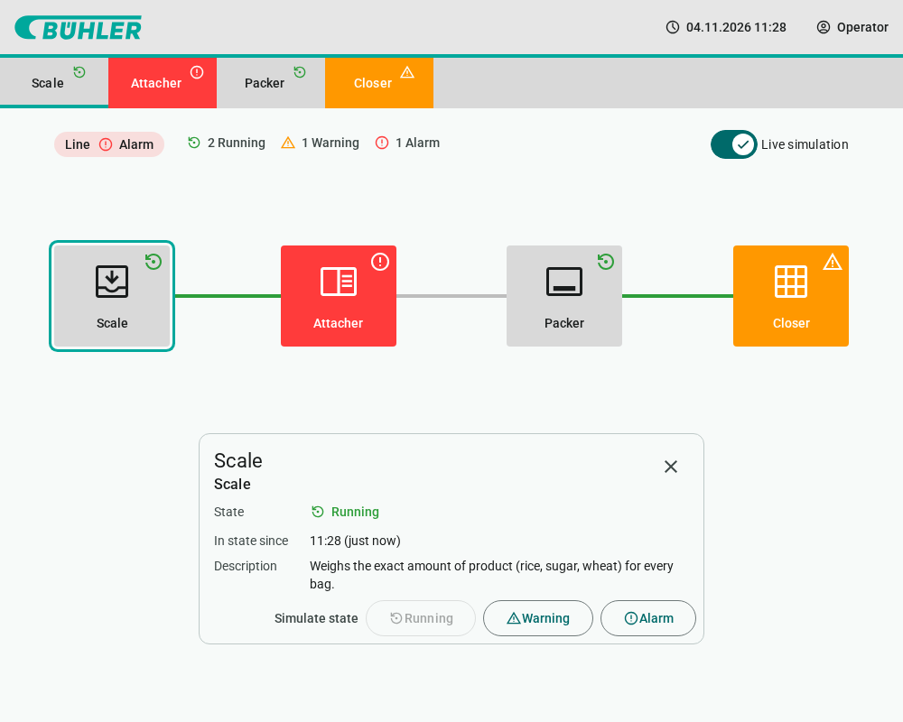
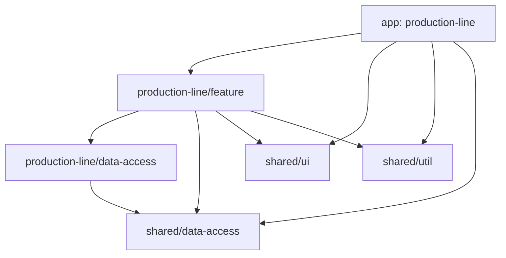

# Bühler bagging line – machine status

Angular application showing the state of every machine (section) of a bagging
production line – **Scale → Attacher → Packer → Closer** – in two places:

- **Navigation** – status tabs under the header
- **Overview** – the line as a flow of status tiles

Every state has its own icon and color (Material Symbols):

| State   | Icon                      | Color  |
| ------- | ------------------------- | ------ |
| Running | `settings_backup_restore` | green  |
| Warning | `warning`                 | orange |
| Alarm   | `error`                   | red    |

Selecting a machine (tab or tile) opens its detail. A **live simulation**
randomly changes machine states every few seconds, and states can be switched
manually in the detail card, so the reactive state flow can be seen in action.



**Live demo:** https://evincars.github.io/angular-entry-test/

## Tech stack

- **Angular 22** – standalone components, **zoneless** change detection,
  signals everywhere (`input()`, `output()`, `model()`, `computed()`),
  new control flow. `OnPush` is the default change detection strategy since
  Angular 22, so it is not repeated in every component.
- **NgRx Signals** – `signalStore` for global and local state
- **Angular Material 3** + **Material Symbols** (`material-symbols` package)
- **Nx 24** monorepo with enforced module boundaries
- **Vitest** unit tests, ESLint, Prettier

## Workspace structure

```
apps/
  production-line/                  app shell: header, routing, theme       type:app
libs/
  shared/
    ui/                             Material wrappers (ui-*)                type:ui
    util/                           pure mappers / formatters               type:util
    data-access/                    global AppStore (clock, user)           type:data-access
  production-line/
    feature/                        navigation, overview, machine detail    type:feature
    data-access/                    machine model, JSON, MachinesStore      type:data-access
```



### Module boundaries

Enforced by `@nx/enforce-module-boundaries` in [`eslint.config.mjs`](eslint.config.mjs):

| Library type       | May import                  |
| ------------------ | --------------------------- |
| `type:feature`     | `data-access`, `ui`, `util` |
| `type:data-access` | `data-access`               |
| `type:ui`          | `ui`                        |
| `type:util`        | `util`                      |

Plus scopes: `scope:production-line` may use `scope:shared`, but not the other
way round. Angular Material may only be imported inside `shared/ui` – features
use the `ui-*` wrappers.

## State management

| Store           | Scope                                 | Holds                                                                                                                           |
| --------------- | ------------------------------------- | ------------------------------------------------------------------------------------------------------------------------------- |
| `AppStore`      | global (`providedIn: 'root'`)         | ticking clock, signed-in user                                                                                                   |
| `MachinesStore` | local (provided on the feature route) | machines loaded via `httpResource`, writable linked copy (`withLinkedState`), selection, counts, overall line state, simulation |

Components are presentational: they receive data through inputs and report
user actions through outputs. The only container, `ProductionLinePage`, maps
the domain model to UI view models (`machine-view.ts`, using `createLookup`
from `shared/util`) and delegates every state change to the stores. The
selected machine comes from the `:machineId` route parameter (component input
binding) and is passed to the store as a signal (`signalMethod`).

Machines are stored in
[`machines.json`](libs/production-line/data-access/src/assets/machines.json)
and validated at runtime with type guards.

## Typing rules

- strict TypeScript and strict templates
- **no type assertions** (`as Foo`, `<Foo>x`) – values are narrowed with type
  guards, object literals are checked with `satisfies`
  (`@typescript-eslint/consistent-type-assertions: never`)
- no `any`, no non-null assertions `!`
- exhaustive lookup tables (`Record<Union, Value>`) – adding a new machine
  state or type is a compile error until it has an icon, color and label

## Getting started

Requires Node.js `^22.22.3 || ^24.15.0 || >=26`.

```sh
npm install
npm start            # http://localhost:4200
```

| Script              | Description                                    |
| ------------------- | ---------------------------------------------- |
| `npm start`         | dev server                                     |
| `npm run build`     | production build → `dist/apps/production-line` |
| `npm test`          | unit tests of all projects                     |
| `npm run lint`      | ESLint incl. module boundaries                 |
| `npm run typecheck` | `tsc --noEmit` of all projects                 |
| `npm run check`     | lint + typecheck + test + build                |
| `npm run graph`     | Nx project graph                               |

## Deployment

[`.github/workflows/deploy.yml`](.github/workflows/deploy.yml) deploys to
GitHub Pages whenever a version tag is pushed:

```sh
git tag v1.0.0
git push origin v1.0.0
```

The workflow lints, typechecks and tests the workspace, builds the app with
the repository name as base href and adds a `404.html` fallback so deep links
(e.g. `/machines/attacher`) work. GitHub Pages has to be set to
**Settings → Pages → Source: GitHub Actions** once.
